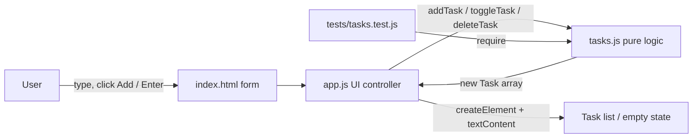

# KAN-116 Architecture: Create Basic To-Do List

Status: amended 2026-10-22 to resolve design-review findings DR-3 to DR-8 (see section 10); re-approved 2026-10-22. Input: `01-requirements.md` (decision `approved`, vasu sachdeva, 2026-10-22). Items tagged [A] are assumptions.

## 1. Repository Context
- `app/` and `tests/` are currently empty (no existing code). CLAUDE.md defines: static app in `app/` (open `app/index.html`), tests via `npm test` = `node --test` on `tests/tasks.test.js`.
- Stack: plain HTML, CSS, and vanilla JavaScript (ES modules-free dual export, see AD-8). No build step, no runtime dependencies, no backend.

## 2. Design Decisions
Stage 01 approval accepted the draft defaults for Q-1 to Q-6; they are recorded below as decisions.

| ID | Decision | Rationale | Resolves |
|----|----------|-----------|----------|
| AD-1 | New tasks are inserted at the top (newest first). | Draft default accepted at stage 01; newest work is visible immediately. | Q-1 |
| AD-2 | Empty or whitespace-only input is ignored (no task created, input keeps focus, no error dialog). Input is trimmed. Max length 200 enforced via `maxlength` and, authoritatively, in the module: trim first, then reject if `.length > MAX_LENGTH` (200 and 201 are boundary tests). Duplicates allowed. [A] | Simplest behavior; limit and duplicates were not specified, so the least restrictive reasonable choice is used. | Q-2, A-3 |
| AD-3 | State is in-memory only; no localStorage. | Story does not mention persistence (A-2); avoids unrequested feature. A storage adapter can be added later without changing the module API. | Q-3, A-2 |
| AD-4 | Completion is a checkbox per task, toggleable both ways; completed tasks stay visible with strikethrough and reduced contrast. | Native checkbox is accessible and needs no extra code. | Q-4, A-5, FR-7 |
| AD-5 | Delete is immediate, with no confirmation or undo. | Matches "permanently removed" (A-4). | Q-5, A-4 |
| AD-6 | Show an empty-state message ("No tasks yet") when the list is empty. [A] | Low-cost clarity for "view what needs to be done"; draft default accepted. | Q-6 |
| AD-7 | Separate pure task logic (`app/tasks.js`) from DOM code (`app/app.js`). | Allows `node --test` without a DOM or browser. | Testability |
| AD-8 | `tasks.js` exports via a dual pattern: `module.exports` when `typeof module !== 'undefined' && module.exports`, else attach to `globalThis.Tasks`. `index.html` loads `tasks.js` before `app.js` with plain `<script>` tags (no `type="module"`), so `app/index.html` works from `file://` (ES modules are blocked from `file://` in browsers). The repo `package.json` (created, CommonJS, no `"type"` field) must keep it that way. | Meets "open `app/index.html`" with no server. | CLAUDE.md |
| AD-9 | Task ids are a monotonically increasing integer counter held in `app.js` (not the module, which stays stateless) and incremented only when `addTask` returns `added: true`. | No dependency or randomness needed; unique within a session; keeps `tasks.js` pure (AD-7). | Data model |

## 3. Components
| Component | File | Responsibility |
|-----------|------|----------------|
| Task logic module | `app/tasks.js` | Pure, DOM-free functions over an array of tasks; no mutation of inputs (returns new arrays). |
| UI controller | `app/app.js` | Wires DOM events to the module, holds current state, calls `render`. Renders via `textContent`/`createElement` only. |
| Markup | `app/index.html` | Form with labeled text input and "Add Task" submit button; `<ul>` task list; empty-state element; live region. |
| Styles | `app/styles.css` | Clean layout, completed-task style, visible focus. |
| Tests | `tests/tasks.test.js` | `node:test` + `node:assert` against `app/tasks.js`. |

### Interfaces (`app/tasks.js`)
- `createTask(id, text)` returns `{ id, text, completed: false }` or `null` if the trimmed text is empty or exceeds 200 characters.
- `addTask(tasks, text, nextId)` returns `{ tasks, added }`: new array with the task at index 0 (AD-1), or the unchanged array and `added: false` when invalid.
- `toggleTask(tasks, id)` returns a new array with that task's `completed` flipped; unknown id leaves the list unchanged.
- `deleteTask(tasks, id)` returns a new array without that task.
- `MAX_LENGTH = 200`.

### Data model
`Task = { id: number, text: string, completed: boolean }`. State is `Task[]` (newest first) plus a `nextId` counter, held in `app.js`. Not persisted.

### Diagram

### Key flows
- Add (FR-1..FR-4): submit event (covers button click and Enter via native `<form>`) -> `addTask` -> if added, increment `nextId`, re-render, clear input; focus returns to input; live region "Task added".
- Complete (FR-7): checkbox change -> `toggleTask` -> re-render; live region "Task completed" / "Task reopened".
- Delete (FR-5, FR-6): trash button click -> `deleteTask` -> re-render; focus moves to the input (the focused button is removed); live region "Task deleted".
- View (FR-8): `render` rebuilds the `<ul>` from state on every change; shows the empty state when the array is empty.

## 4. Traceability
| Requirement | Component / decision |
|-------------|----------------------|
| FR-1 text input and "Add Task" button | `index.html` form; AD-2 |
| FR-2 click or Enter adds task | Native form `submit` handler in `app.js` |
| FR-3 appears immediately, active, position | `addTask` (`completed: false`); synchronous render; AD-1 |
| FR-4 input clears | `app.js` clears input after `added: true` |
| FR-5 Delete (trash icon) button per task | `render` in `app.js`; button with trash icon and `aria-label`; AD-5 |
| FR-6 permanent removal | `deleteTask`; AD-3, AD-5 |
| FR-7 mark complete | `toggleTask`; checkbox; AD-4 |
| FR-8 show task list | `render` and empty state; AD-6 |

All FR-1..FR-8 are mapped; no gaps.

## 5. Security (OWASP Top 10)
- A03 Injection / XSS: task text is untrusted input; render only with `textContent` or `createElement`, never `innerHTML`. Trash icon is an inline text/emoji glyph or static SVG written in markup, not built from user data.
- Input validation: trim, reject empty, enforce 200-character cap in the module (not only via HTML attribute).
- A02/A05/A07 and others: no authentication, secrets, backend, network calls, or storage, so the attack surface is minimal. No third-party scripts or CDN assets (A06/A08). No `Content-Security-Policy` meta tag (it behaves inconsistently under `file://` for little gain); the `textContent`-only rule is the XSS control. All JS and CSS stay in external files, with no inline scripts, styles, or handlers.
- No secrets in code or artifacts.

## 6. Accessibility
- Visible `<label>` for the input; buttons are real `<button>` elements.
- Delete button has `aria-label="Delete task: <text>"` (set via `setAttribute`), icon is `aria-hidden`.
- Completion uses a native checkbox associated with its text via `<label>`; completed state is not conveyed by color alone (strikethrough).
- Polite `aria-live` region announces add/delete; focus visible; keyboard-complete operation; sufficient color contrast (WCAG AA) [A: no target stated in Jira, AA used as a sensible default].

## 7. Testability
- All logic is in `tasks.js`, runnable under `node --test` with no DOM: add (trim, empty, whitespace, length boundaries 200 and 201, whitespace-padded input, top placement, active status, immutability), toggle (complete, un-complete, unknown id), delete (removal, others unaffected, unknown id), id uniqueness over several adds and deletes.
- Completion has no Jira acceptance criterion; its evidence is labeled "derived from AD-4, not a Jira AC".
- DOM wiring in `app.js` is thin; verified by a manual checklist in stages 04/07: Enter key, click, input clears, delete icon, empty state, keyboard-only pass (focus after delete, live-region messages), and opening `app/index.html` from `file://`. Code review greps for `innerHTML`. Browser automation is not introduced (unrequested).

## 8. Integrations
None. No Jira/GitHub calls at runtime, no network, no storage.

## 9. Risks
| ID | Risk | Mitigation |
|----|------|------------|
| AR-1 | DOM behavior (Enter, clear, focus) not covered by `node --test`. | Native `<form>` minimizes custom code; explicit manual checklist in stage 04/07. |
| AR-2 | Dual-export pattern breaks if `package.json` uses `"type": "module"`. | `package.json` now exists as CommonJS (no `"type"`); AD-8 documents the constraint. |
| AR-3 | In-memory state loses tasks on reload (AD-3). | Accepted per stage 01; adapter seam kept for future storage. |
| AR-4 | XSS via task text if `innerHTML` used. | Rule in section 5; code review to check. |
| AR-5 | Completion has no Jira acceptance criterion (R-2). | Behavior fixed by AD-4 and unit-tested; design review should confirm. |
| AR-6 | 200-character cap and AA contrast are assumptions. | Marked [A]; trivial to change via `MAX_LENGTH`/CSS. |

## 10. Amendment Log (2026-10-22)
Original approval (vasu sachdeva, 2026-10-22, "approved by vasu sachdeva for stage 2") covered the pre-amendment text. Changes made at the user's request to eliminate design-review risks; the approval was reset to `pending` and then re-granted by vasu on 2026-10-22 (section 11).
| Finding | Resolution |
|---------|------------|
| DR-1 | Removed `storage.js` from `README.md` layout line (no storage per AD-3). |
| DR-2 | Created `package.json` (CommonJS, `npm test`) and `tests/validate-story.ps1`. Both are new, unreviewed files. |
| DR-3 | Section 7: explicit toggle tests and "derived from AD-4" labeling. |
| DR-4 | Section 5: CSP dropped; external JS/CSS only. |
| DR-5 | AD-9: `nextId` in `app.js`, incremented only on `added: true`. |
| DR-6 | AD-2: trim then `.length > MAX_LENGTH`; 200/201 boundary tests. |
| DR-7 | Section 3 flows: focus to input after delete; live-region messages. |
| DR-8 | AD-8: `typeof module` guard; script load order. |
Residual (cannot be eliminated): AR-1 DOM behavior is manual-only; AR-3 tasks are lost on reload (accepted at stage 01); AR-5/AR-6 are assumptions.

## 11. Approval
| Field | Value |
|-------|-------|
| Decision | approved |
| Approver | vasu |
| Rationale | User replied "approved by vasu" directly in the main session after the amendment (section 10). |
| Evidence | User message in main session; sections 2 to 10 of this artifact; `01-requirements.md` section 12 |
| Timestamp | 2026-10-22 |
| Next agent | `design-review` (only after decision is `approved`) |
