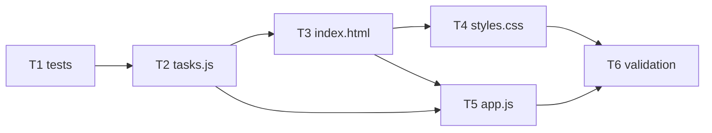

# KAN-116 Implementation Plan: Create Basic To-Do List

Status: drafted 2026-10-22. Input: `03-design-review.md` (decision `approved`, Vasu Sachdeva, 2026-10-22; matches `pipeline-state.json`). `02-architecture.md` section 11 and `pipeline-state.json` are authoritative for approval status (DR-9). Scope: local only; stages 01-07 need no GitHub. Plan only, no application code.

## 1. File Layout
| File | State | Owner task |
|------|-------|-----------|
| `tests/tasks.test.js` | new | T1 |
| `app/tasks.js` | new | T2 |
| `app/index.html` | new | T3 |
| `app/styles.css` | new | T4 |
| `app/app.js` | new | T5 |
| `package.json`, `tests/validate-story.ps1` | exist; do not recreate; `package.json` stays CommonJS, no `"type"` (AR-2, AD-8) | none (T6 only runs them) |

## 2. Tasks
| ID | Task | Depends on | Covers | Resolves | Verification |
|----|------|-----------|--------|----------|--------------|
| T1 | Write `tests/tasks.test.js` (`node:test` + `node:assert`, `require('../app/tasks.js')`). Cases: add (trim, empty, whitespace-only, exactly 200 ok, 201 rejected after trim, padded input trimmed then measured, new task at index 0, `completed:false`, input array not mutated, `added:false` returns unchanged array); toggle (complete, un-complete, unknown id unchanged, immutability); delete (removal, others unaffected and order kept, unknown id unchanged); id uniqueness over several adds/deletes using an `app.js`-style counter incremented only on `added:true`. Label toggle tests "derived from AD-4, not a Jira AC". | none | FR-2..FR-4, FR-6, FR-7 | DR-3, DR-5, DR-6, DR-11 | `npm test` fails at this point only because `app/tasks.js` is missing (expected red). |
| T2 | Write `app/tasks.js`: `MAX_LENGTH=200`, `createTask`, `addTask`, `toggleTask`, `deleteTask`; pure, no DOM, no mutation, no id state; export via `typeof module !== 'undefined' && module.exports` else `globalThis.Tasks`. | T1 | FR-3, FR-4, FR-6, FR-7 | AD-1, AD-2, AD-7, AD-8, DR-6, DR-8 | `npm test` all green; record exact command, pass count, result. |
| T3 | Write `app/index.html`: labeled text input (`maxlength=200`), `<form>` with "Add Task" submit button, `<ul>` list, empty-state element ("No tasks yet"), polite `aria-live` region. Plain `<script src="tasks.js">` then `<script src="app.js">`, no `type="module"`, no inline script/style/handler, no CSP meta, no CDN. | T2 | FR-1, FR-2, FR-8 | AD-2, AD-6, AD-8, DR-4, DR-7, DR-8 | Grep `app/` for `<script>` bodies, `style=`, `on\w+=`, `Content-Security-Policy`, `type="module"`: no hits. Script order tasks.js before app.js. |
| T4 | Write `app/styles.css`: clean layout, completed-task strikethrough plus reduced contrast (AA), visible `:focus-visible` styling, trash button styling. | T3 | FR-7, FR-8 | AD-4, AR-6, accessibility section | Manual checklist M7/M8 (visual). |
| T5 | Write `app/app.js`: state `Task[]` plus `nextId` owned here (incremented only when `addTask` returns `added:true`); submit handler (native form: Enter and click); clear input and refocus on add; checkbox toggle; trash `<button>` with `aria-label="Delete task: <text>"` via `setAttribute` and `aria-hidden` icon; after delete focus the input; `render` rebuilds list via `createElement`/`textContent` only and shows empty state; live-region messages "Task added", "Task completed", "Task reopened", "Task deleted"; empty/whitespace input keeps focus, no dialog. | T2, T3 | FR-1..FR-8 | AD-1, AD-3, AD-5, AD-6, AD-9, DR-4, DR-5, DR-7 | Grep `app/` for `innerHTML`, `insertAdjacentHTML`, `outerHTML`, `document.write`, `eval`, `localStorage`, `fetch`: no hits. Manual checklist below. |
| T6 | Run full local validation and record results for stages 05/07: `npm test`; manual checklist; security greps; `pwsh tests/validate-story.ps1 -JiraId KAN-116` (at stage 07, after artifacts 01-06 exist; stage 05 may run it and record expected failures for missing 06/07 artifacts). Consider also checking approvals of stages 01-05 in the script only if the user asks (it is an unreviewed file; do not edit it unrequested). Docs use the `pwsh tests/validate-story.ps1` form. | T1-T5 | all | DR-9, DR-10, DR-11 | Commands recorded verbatim with result in `05-implementation-summary.md`. |

## 3. Dependency Diagram

Acyclic. Order: T1, T2, T3, T4, T5, T6.

## 4. Validation Strategy
- Unit: `npm test` (T2 onward green). Covers FR-3, FR-4, FR-6, FR-7 logic; first recorded run is after T1+T2 (DR-11).
- Acceptance (AC-1, AC-2): manual DOM checklist below; completion evidence labeled "derived from AD-4, not a Jira AC".
- Security: greps in T3/T5 (no `innerHTML` and similar, no inline JS/CSS, no CSP, no network/storage, no secrets); trim and 200 cap enforced in `tasks.js`, not only via `maxlength`.
- Pipeline: `pwsh tests/validate-story.ps1 -JiraId KAN-116`.

### Manual DOM checklist (open `app/index.html` directly via `file://`; record pass/fail per item)
| # | Check | Expected |
|---|-------|----------|
| M1 | Page opens from `file://` with no console errors | Form, empty state "No tasks yet" shown |
| M2 | Type text, press Enter | Task appears at top, active; live region "Task added" |
| M3 | Type text, click "Add Task" | Same as M2 |
| M4 | After add | Input cleared and focused |
| M5 | Submit empty and whitespace-only input | No task, input keeps focus, no dialog |
| M6 | Add 3 tasks | Newest first |
| M7 | Check and uncheck a task | Strikethrough and reduced contrast, then restored; "Task completed" / "Task reopened" |
| M8 | Click trash icon on a task | Task removed permanently, others unchanged; "Task deleted" |
| M9 | Delete all tasks | Empty state returns |
| M10 | Keyboard only (Tab, Space, Enter): add, toggle, delete | Operable; focus visible; after delete focus lands on input |
| M11 | Enter `<b>x</b>` as task text | Shown literally, not rendered as HTML |
| M12 | Type 201+ characters | Input capped by `maxlength`; module rejects >200 after trim |

## 5. Artifacts Later Stages Must Write
- `docs/KAN-116/05-implementation-summary.md` (commands run with results, files changed, checklist results, deviations)
- `docs/KAN-116/06-code-review.md` (CR-n findings, `innerHTML` grep result)
- `docs/KAN-116/07-verification-report.md` (`npm test`, checklist, `validate-story.ps1` result, release-readiness decision)
- `docs/KAN-116/08-pr-summary.md` (stage 08, after release approval; GitHub use is only here)
- Each ends with an approval block; `pipeline-state.json` updated only by the orchestrator.

## 6. Risks and Mitigations
| ID | Risk | Mitigation |
|----|------|-----------|
| PR-1 | DOM behavior is manual-only (AR-1). | Explicit checklist M1-M12 with recorded results; thin `app.js`. |
| PR-2 | Adding `"type":"module"` would break the dual export (AR-2). | Do not touch `package.json`; code review checks. |
| PR-3 | Unreviewed `validate-story.ps1` hides defects until stage 07 (DR-10). | Run it at stage 05 for early signal and again at stage 07; do not edit without request. |
| PR-4 | No persistence (AR-3), 200 cap and AA are assumptions (AR-6). | Accepted at stage 01/02; `MAX_LENGTH` and CSS are easily changed. |
| PR-5 | `npm test` fails if run before T1/T2 (DR-11). | T1 and T2 first; record only the post-T2 result as evidence. |

## 7. Out of Scope
Persistence/localStorage, edit task, undo/confirm on delete, filtering/sorting, backend, build tooling, browser automation, CSP, new agents/hooks, GitHub use in stages 01-07, editing `package.json` or `validate-story.ps1`, normalizing the approver name in `02-architecture.md` (optional, DR-9).

## 8. Approval
| Field | Value |
|-------|-------|
| Decision | approved |
| Approver | vasu sachdeva |
| Rationale | User replied "approved by vasu sachdeva for stage 4" directly in the main session. |
| Evidence | `03-design-review.md` sections 4 and 6; `02-architecture.md`; `package.json`; `tests/validate-story.ps1` |
| Timestamp | 2026-10-22 |
| Next agent | `implementation` (only after decision is `approved`) |
